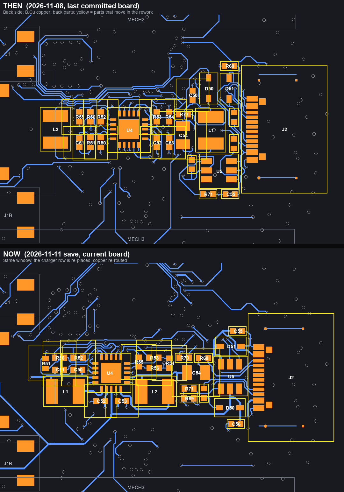
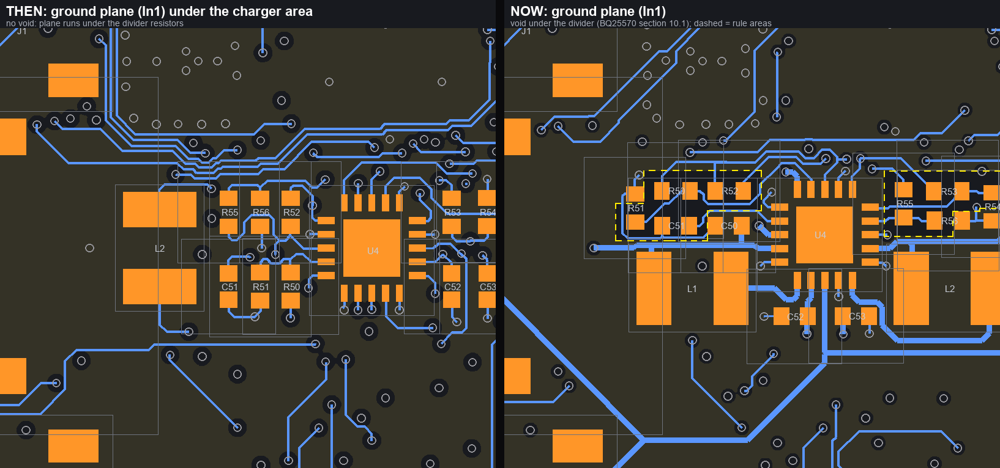
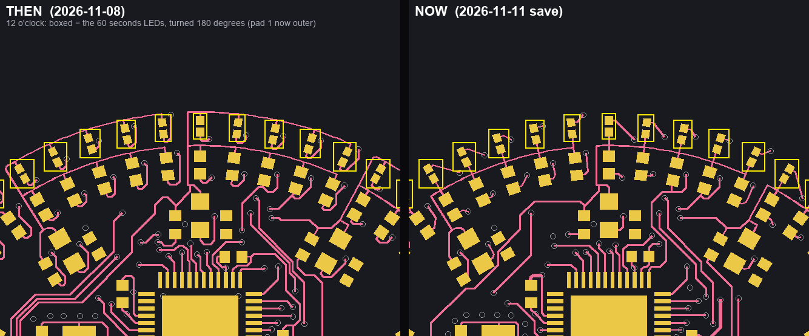
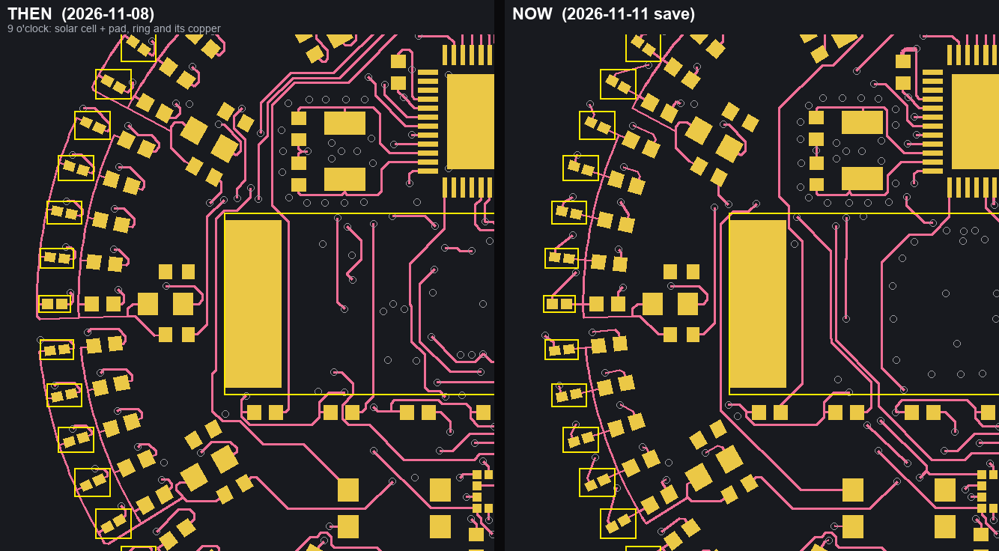
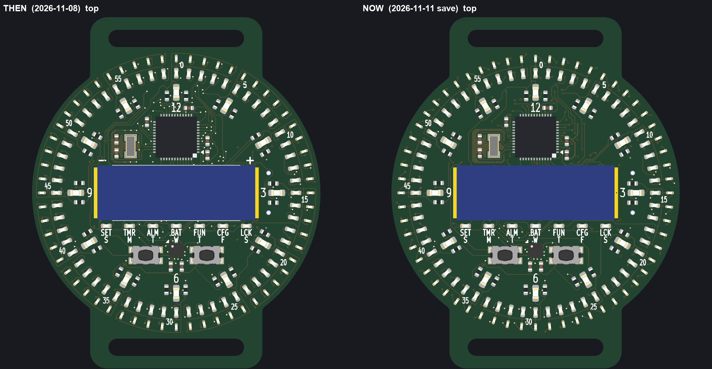
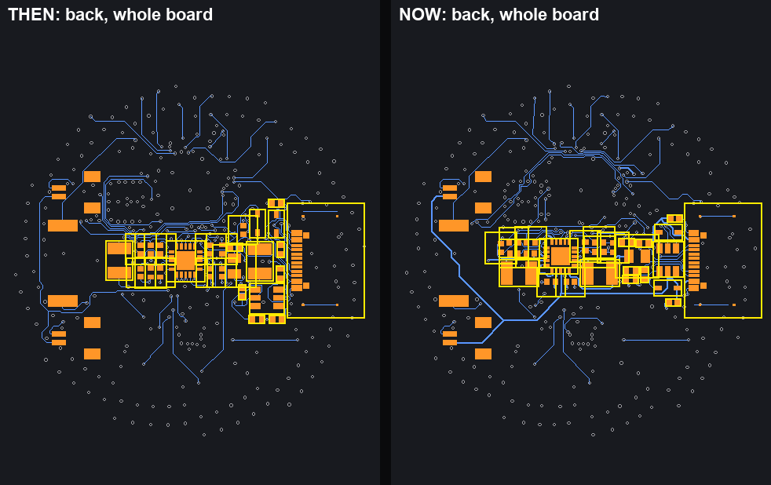
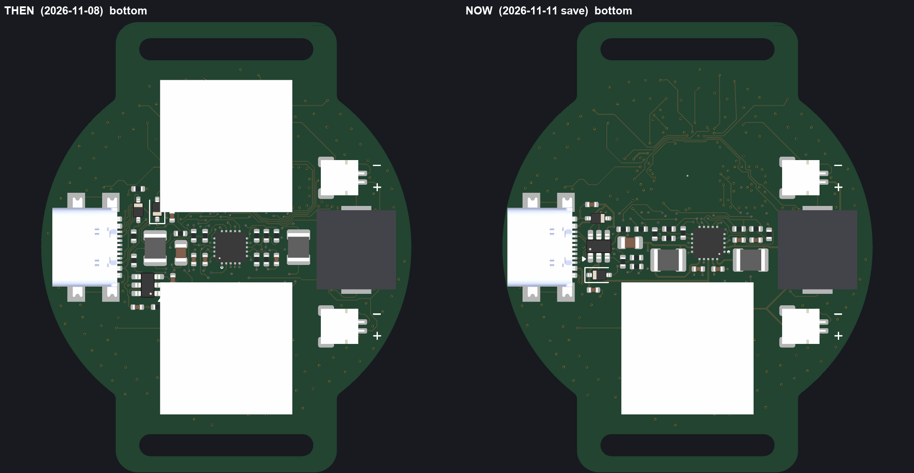

# Then and now: what changed on the board (for a reviewer)

**Then** = the board as last committed before the charger-core rework, git commit `350f9ec`, 2026-11-08.
**Now** = the working board `hardware/LED Watch - Single Color.kicad_pcb`, save of 2026-11-11 05:14 (DRC 0 violations / 0 unconnected, all 65 nets one piece).
Both are drawn from the board files themselves by the same script, on a dark background: blue = back copper, pink = front copper, orange / gold = pads, grey rings = vias, yellow outline = parts that changed, olive = ground plane on In1.

## 1. Charger block on the back (the big change)

30 parts moved more than 0.05 mm, all of them the charger / USB-C corner:

| Part | Moved (mm) | | Part | Moved (mm) |
|---|---|---|---|---|
| L1 (boost inductor) | 15.3 | | R69 | 5.9 |
| C50 | 12.3 | | R50 | 5.6 |
| C55 | 11.7 | | R51 | 5.5 |
| L2 (buck inductor) | 10.5 | | R68 | 5.3 |
| D50 | 7.8 | | C53 | 5.0 |
| R56 | 6.7 | | C56 | 4.8 |
| R70 | 6.3 | | U5 (BQ21040) | 4.6 |
| R55 | 6.2 | | R72 | 3.9 |
| R71 | 6.0 | | C51 | 3.0 |
| C52 | 6.0 | | R52, U4, C54 | 2.5, 1.9, 1.8 |

Smaller shifts (all under 1 mm): D51, R53, R54, C10, the crystal block (Y1, C20, C21 moved 0.58 mm together) and J2 (0.7 mm).
What it means: U4 now has its power side on one row below it with the two inductors flanking it, the divider resistors are grouped beside it, and the USB side (U5, D50, D51, C56, R68-R72) is regrouped against J2.

## 2. Ground plane void under the divider

New since "then": the In1 ground plane is cut away under the voltage-setting resistors and the sample capacitor (BQ25570 data sheet section 10.1, "highly recommended that no ground planes be poured near the voltage setting resistors or the sample and hold capacitor"). Yellow dashes are the rule areas; the owner hand-edited them.

## 3. Front: seconds ring and solar cell

- The 60 seconds LEDs (boxed) are turned 180 degrees: pad 1 (the row line) is now the outer pad, pad 2 (the column line) the inner one. The solar cell footprint SC1 was rotated with them.
- Ring copper was tidied: fewer, longer pieces, track ends on pad and via centres, exact joints.
- The solar-cell polarity marks moved inside the cell area (covered when the cell is soldered), no silk lines around the cell.

## 4. The back as a whole

(The two white blocks in the 3D picture are the LiPo placeholder models.)

## Numbers
| | Then | Now |
|---|---|---|
| Footprints | 208 | 207 (MECH2, the upper LiPo placeholder, is gone: not recorded in the decision log, to confirm) |
| Track pieces | 2607 | 1926 (merged into longer pieces; total copper length 3181 mm -> 3527 mm) |
| Vias | 342 | 317 |
| In1 ground void | none | rule areas under the divider and sample capacitor (hand-edited by the owner) |

## Other changes that do not show in a picture
- C56 reaches the charger by 4.4 mm of copper (was 14.5) after CC2 was routed round the south of it; the BQ21040 data sheet (11.1) wants IN and OUT capacitors close.
- Exposed pads of U1 and U4: one centre via each; crystal guard vias kept.
- Production files (gerbers, BOM, placement) regenerated; the J2 placement has a 1.10 mm correction because JLCPCB's connector model has a different origin (`JLCPCB-ORDER-NOTES.md`).
- Open points are listed in `REVIEW-2026-11-11.md`.
